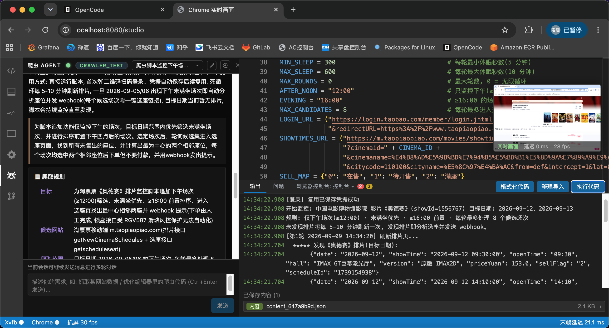

<div align="center">

[简体中文](./README.md) | **English**

# 🖥️ AgentCrawlerStudio

**Xvfb virtual display + headed real Chrome window + Pillow screen capture, streamed over WebSocket to a browser-based remote console**

No ffmpeg dependency · sub-20ms end-to-end latency · the live view is directly remote-controllable with mouse/keyboard · built-in Playwright / Pyright LSP / source version control / crawler Agent


</div>

---

A console project that streams a **real browser window** (including tab bar / address bar) to a web page **in real time with millisecond latency**:

- Runs **headed Chrome** on an Xvfb virtual display; Pillow grabs the screen directly and JPEG-encodes it, streamed over WebSocket — **no ffmpeg at all**.
- Enlarge the floating live view to **directly remote-control** this real browser with mouse / wheel / keyboard (including Chinese IME input) — no code to write.
- Built-in **Playwright code editor** (Monaco + Pyright LSP) to write scripts that drive the browser, with **streaming stdout echo** and the ability to **stop execution** at any time.
- Built-in **DevTools-style panels** (Console / Elements / Network / Application).
- Built-in **source version control**: editor code is committed / history / checked out by `crawler_id` (persisted in MongoDB), with automatic three-way merge of uncommitted drafts.
- Built-in **crawler Agent** (LangChain + DeepAgents), a session-based multi-turn chat that automatically writes and delivers crawler scripts, with screenshot-based visual judgment and **automatic human-verification handling**.
- **Three run modes (`dev` / `login` / `run`)**: a dev container, a login-only container that saves credentials, and a headless one-shot / scheduled executor with webhook callbacks — directly reusable by K8s / scheduling platforms.

## 📑 Table of Contents

- [✨ Features](#-features)
- [🖼️ Interface Preview](#️-interface-preview)
- [🏗️ Architecture](#️-architecture)
- [⚡ Millisecond-level Latency](#-millisecond-level-latency)
- [🚀 Quick Start](#-quick-start)
  - [Requirements](#requirements)
  - [Install & Run](#install--run)
  - [Frontend Dev Mode](#frontend-dev-mode)
  - [UI Overview](#ui-overview)
- [⚙️ Configuration](#️-configuration)
- [🧭 Run Modes (dev / login / run)](#-run-modes-dev--login--run)
- [🔌 HTTP/WS API](#-httpws-api)
- [📖 User Guide](#-user-guide)
  - [Playwright Code Control](#playwright-code-control)
  - [Built-in Crawler Helper Functions](#built-in-crawler-helper-functions)
  - [Login Credential Reuse](#login-credential-reuse)
  - [Automatic Human-Verification Handling](#automatic-human-verification-handling)
  - [Remote Browser Control](#remote-browser-control)
  - [Source Version Control](#source-version-control)
  - [Export Script (Standalone Package)](#export-script-standalone-package)
  - [Crawler Agent](#crawler-agent)
- [🧪 Tests](#-tests)
- [❓ FAQ](#-faq)
- [🤝 Contributing](#-contributing)
- [📄 License](#-license)

## ✨ Features

| Capability | Description |
|------|------|
| **Millisecond real-time view** | 30fps continuous capture + WebSocket push of the latest frame; last-frame latency on static pages stays at ~20ms |
| **Remote control of the view** | After enlarging the floating view, mouse / wheel / keyboard / Chinese input drive the real browser directly (CDP Input injection), no code needed |
| **Single-window exclusive connection** | Only one window may connect to view and control the live view at a time; a second window is prompted to "take over / cancel" |
| **No ffmpeg dependency** | Pillow `ImageGrab` reads the X11 screen directly; JPEG encoding is ~25ms per frame, fully async without blocking |
| **Real browser window** | Headed Chrome (with address bar / tab bar) rendered in the view; navigation / remote control / DevTools share the **same persistent window**, while running code automatically restarts a **fresh browser** (brand-new temp profile dir) |
| **Playwright console** | Monaco editor + output bar "Execute code" (or `Ctrl+Enter`) to run, with preset `page` / `context` / `browser`; stdout **SSE streaming echo** (timestamped + blinking cursor), one-click **Stop execution** while running |
| **Pyright LSP** | Inline type inference / completion / hover / go-to-definition / diagnostics, on par with Pylance precision |
| **DevTools panels** | Console / Elements / Network / Application, four panels closely matching Chrome DevTools |
| **Code assistance** | black formatting, isort import sorting, auto-import quick fix, inlay hints |
| **Source version control** | Editor code commit / history / checkout by `crawler_id` (commits persisted in MongoDB); the uncommitted draft is stored in browser localStorage and auto three-way merged with remote changes on refresh |
| **Export script** | One-click export of editor code into a standalone `uv`-runnable project zip (pyproject.toml + README + main.py + runtime), no Xvfb needed, supports immediate run / cron-scheduled run with cron validation, and an optional headless/headed default |
| **Crawler Agent** | Session-based multi-turn chat that automatically plans → debugs → writes scripts back, with interactive login, screenshot-based visual judgment and process narration |
| **Login credential reuse** | Tickets stored in MongoDB by host + crawler_id; log in once and reuse automatically |
| **Three run modes** | `dev` full IDE; `login` auto-runs the Mongo HEAD code until "logged in and credential saved"; `run` starts no web server, executes once / on a cron schedule and calls back webhooks |
| **Automatic human-verification handling** | Slider (with gap) / "I'm human" checkbox / image point-click: the Agent uses `detect_verification` / `solve_verification` during development, while delivered scripts use `verify_check` to auto-solve at runtime (no pop-up; ends the run when attempts are exhausted) |
| **Visual judgment** | The `browser_screenshot` Agent tool captures the current page and hands it to the multimodal main model as an image — "use your eyes" when DOM/text is inconclusive |
| **Theme & UI language** | Light / dark / follow-system theme, one-click Chinese / English UI switch |
| **Result download** | Saved content in the output bar can be downloaded directly (HTML / JSON / CSV / images, etc.) |

## 🖼️ Interface Preview

> The page uses a VSCode-style layout: left activity bar → side panel / Monaco code editor → bottom output bar (Output / Problems / Browser Console) / bottom status bar (Xvfb / Chrome / capture fps / last-frame latency), with the floating real Chrome live view in the top-right (click to enlarge and then control directly).



## 🏗️ Architecture

```
+-----------+    X11    +------------------+               +--------------+
|   Xvfb    |<----------| Chrome (headed)  |  <---CDP----  |  Playwright  |
| :99 virt. |           | real window+bar  |  (ws 9222)     |  (code exec) |
+-----+-----+           +------------------+               +--------------+
      ^ Pillow ImageGrab (XGetImage direct read)   ^
      |                                            | CDP Input injection
      |                                            | (mouse/wheel/keys/touch/text)
      v JPEG encode (Pillow, ~25ms/frame)          |
+--------------------------------------------+     |
| FastAPI (fully async)                      |     |
|  /ws/live  live view (latest frame         |     | <---+
|            only, single window)            |
|  /ws/input remote-control duplex           |
+--------------------------------------------+
```

- **Xvfb**: virtual display `:99` (1280x800x24), where headed Chrome renders.
- **Chrome**: runs in headed mode; its **real browser window (with tab bar / address bar)** is shown in the view — no URL argument, landing on the default blank page. Navigation / remote control / live view / DevTools panels share the **same persistent browser** (a brand-new temp `--user-data-dir` profile, non-incognito — incognito breaks CDP's Cookie API); each `POST /run` automatically restarts a **fresh browser** (reallocating a temp profile dir and CDP port). `--remote-debugging-port` exposes CDP for Playwright and all control channels, leaving no history / cookies behind.
- **Capture**: Pillow `ImageGrab` reads the virtual screen directly → JPEG encoding, **with no ffmpeg involved**; capture runs in a backend asyncio background task, with each frame's grab / encode offloaded to the default executor (`asyncio.to_thread`), keeping the event loop always idle.
- **FastAPI**: fully async (async/await), **threadless** — no endpoint or WebSocket blocks the event loop; a dedicated asyncio capture task continuously captures and encodes at 30fps, and the WebSocket only pushes the latest frame. The live view `/ws/live` is **single-window exclusive**: only one connection at a time; a new window first receives `conflict`, then the client decides to cancel or send `kick` to take over the previous connection (same-page refresh takes over silently). Routes are mounted according to `--mode`: `dev` mounts everything; `login` mounts only the console + live view/DevTools streams + mode/login status; `run` builds no web app and goes straight to the CLI executor. All web modes expose a `GET /healthz` readiness probe.
- **Remote control**: once enlarged, the live view becomes an overlay that forwards mouse / wheel / keyboard / Chinese IME events over `/ws/input` to the backend, which injects them into the persistent browser via the **CDP Input domain** (coordinates are auto-converted to remove the browser top-bar offset).
- **Fully async dependencies**: browser control uses the **Playwright async API**, network requests use the `httpx` async client, MongoDB uses the **motor** async driver, and the LSP bridge uses `asyncio.create_subprocess_exec` + async stdio.
- **Code execution**: `POST /run` streams back via **SSE** (`start → stdout… → done`, `heartbeat` when idle); `print` in the script is pushed to the page line by line in real time, and the client can abort the request at any time to **stop execution**; scripts run in a worker thread with a separate event loop, without blocking the event loop.
- **Crawling & post-processing**: the backend ships `httpx`, `BeautifulSoup` / `lxml`, which can be `import`ed directly in the code editor; type analysis via **pyright** uses `.venv/bin/python` as the interpreter and provides completion / signature help / hover docs based on the packages actually installed in the venv (while keeping `frontend/src/libApi.json` as a library index for variable semantic highlighting). Besides third-party libraries, it covers common stdlib modules such as `os` / `os.path` / `sys` / `re` / `json` / `time` / `datetime` / `math` / `random` / `pathlib` / `html` / `hashlib` / `base64` / `csv` / `collections` / `itertools` / `functools` / `subprocess` / `glob` / `shutil` / `string` / `urllib.parse` / `urllib.request`.
- **Persistence**: MongoDB stores sessions / messages / checkpoints (crawler Agent), login credential tickets (`login_tickets`), and code commit snapshots (`code_commits` / `code_repos`), all isolated by `crawler_id`; uncommitted editor content (source-control draft) is saved by the browser `localStorage`.

### ⚡ Millisecond-level Latency

- Continuous capture (30fps) keeps the view always fresh; **"last-frame latency" on static pages also stays at ~20ms**, never growing over time.
- The WebSocket pushes the latest frame and drops old frames for slow clients, with no buffer backlog.
- Measured (1280x800): about **30fps, end-to-end latency p50 ≈ 16ms, p90 ≈ 21ms**.

## 🚀 Quick Start

### Requirements

| Dependency | Description |
|------|------|
| `uv` | Python package manager |
| `Xvfb`, `chromium` / `google-chrome` | System tools |
| CJK fonts | Required when Chinese text renders as boxes |

```bash
# Debian/Ubuntu
apt install xvfb chromium fonts-noto-cjk
# Fedora/Rocky
dnf install xorg-x11-server-Xvfb chromium google-noto-sans-cjk-ttc-fonts
```

### Install & Run

```bash
# 1. Install backend dependencies (Python 3.12+)
uv sync

# 2. Build the frontend (on first run or after any frontend change; also regenerates the code-completion index)
./build.sh

# 3. Start (runs in the background, log: .app.log)
./run.sh
# Or run in the foreground:
uv run python -m backend.main

# Stop
./stop.sh
```

Once started, visit: **http://\<host-IP\>:8080**

> All API/WS endpoints are mounted under a configurable prefix, defaulting to **`/api/v1`** (e.g. `/api/v1/status`, `/api/v1/ws/live`), with the web console `GET /` as the only exception. The API/WS prefix is changed via `--api-prefix` or the `API_PREFIX` env var, and the frontend automatically reads it from the backend-injected `acs-api-prefix` meta to issue requests (no rebuild needed). The prefix for the web console entry and static assets is changed via `--web-prefix` or the `WEB_PREFIX` env var (default `/`; set it to e.g. `/studio` for sub-path deployment): the page, static assets, API and WS then all live under `/studio` (e.g. `/studio/api/v1/status`, `/studio/api/v1/ws/live`) and the frontend includes that prefix automatically (the injected meta already contains `web_prefix`), so both reverse-proxy modes (keeping or stripping the sub-path) work; the bare `/api/v1` remains available for backward compatibility (old scripts/probes).

> The commands above start the full IDE in `dev` mode by default; for `login` / `run` modes (automatic login, one-shot/scheduled execution + webhooks), see [Run Modes](#-run-modes-dev--login--run).

### Frontend Dev Mode

The frontend is React + Vite; the code editor is based on monaco-editor/react + monaco-languageclient, bridging over WebSocket to the **pyright language server** started by the backend, and the build output goes to `static/`.

```bash
cd frontend && npm run dev    # hot reload, auto-proxies the backend on 8080, open http://127.0.0.1:5173
```

The backend code lives in `backend/`, split by layer:

```
backend/
├── main.py          # Entry: FastAPI app factory + lifecycle
├── config.py        # Config layer: Config / CLI args / utilities
├── schemas.py       # Schema layer: request/response constraints (Pydantic models)
├── services/        # Service layer: capture, Xvfb/Chrome chain, Playwright control, remote control, LSP bridge
│   ├── capture.py   #   Subscriber / ScreenCapture capture asyncio task
│   ├── browser.py   #   BrowserStream subprocess and browser control (async Playwright)
│   ├── cdp.py       #   CDPManager: generic CDP session/channel/event dispatch
│   ├── input.py     #   InputInjector: remote control (mouse/wheel/keyboard/touch/text via CDP Input)
│   ├── console.py   #   ConsoleChannel: DevTools Console sync
│   ├── network.py   #   NetworkChannel: network request recording and response bodies
│   ├── dom.py       #   DOMChannel: DOM tree and element box model (highlighting)
│   ├── storage.py   #   StorageChannel: Local/Session Storage/Cookies/IndexedDB
│   ├── code_version.py # CodeStore: editor code commit snapshots (MongoDB, by crawler_id)
│   ├── lsp.py       #   LspManager / LspSession: browser WebSocket <-> pyright subprocess bridge
│   ├── crawler.py   #   Default crawler functions injected into the execution env (save_page/save_content/login credentials/verify_check, etc.)
│   ├── sandbox.py   #   Restricted sandbox safe_builtins: blocks open/os/pathlib/shutil/subprocess, etc.
│   ├── save.py      #   save_content multi-format serialization (txt/json/jsonl/csv/img) and byte truncation
│   ├── cron.py      #   Cron expression validation and next run time (stdlib only, reused verbatim in the exported package)
│   ├── exporter.py  #   Export a standalone package: assemble the uv project zip (pyproject.toml/README/main/runtime/crawler)
│   ├── runmode/     #   Run modes: login_mode (auto-login until credentials saved) run_mode (once/cron executor)
│   │                #   runtime (standalone Playwright runtime) webhook/heartbeat/data_webhook (callbacks/heartbeat/data push)
│   └── agent/       #   Crawler Agent: agent(create_deep_agent) runner(session orchestration/event persistence)
│                      #   core/(LLM + virtual filesystem) session/(store/event/model) tools/(browser/HTTP/
│                      #   editor/planning/save/verification) verify/(evidence/classification/solvers)
│                      #   login + run_login(login gate) middleware prompts checkpointer
└── routers/         # Routing layer: HTTP/WS endpoint definitions
    ├── console.py   #   GET /
    ├── control.py   #   /status /pages /navigate /screenshot /run(SSE) /restart /console/* /network/* /dom/* /storage/* /format /organize-imports
    ├── input.py     #   /ws/input (remote-control duplex WebSocket)
    ├── versions.py  #   /code/repo /code/commit /code/commits /code/checkout (source version)
    ├── export.py    #   /code/validate-cron /code/export (cron validation + standalone package export)
    ├── runmode.py   #   /mode /login/status (run-mode info + login-mode status)
    ├── lsp.py       #   /ws/lsp WebSocket + /lsp/info
    ├── stream.py    #   /ws/live + /ws/console + /ws/network + /ws/dom + /ws/storage + /live.mjpg
    └── agent.py     #   Agent session management / multi-turn chat / questionnaire / login / /ws/agent / /editor/code
```

### UI Overview

- The main body uses a **VSCode-style layout**: leftmost activity bar → side panel / the **code editor filling the entire page**, **bottom output bar**, and bottom status bar (Xvfb / Chrome / capture fps / last-frame latency).
- **Playwright code editor** (monaco-editor): **fills the entire page**; running code automatically restarts a fresh browser (brand-new temp profile dir), supports `Ctrl+Enter` to run; while running, the bottom-right "Execute code" button becomes **"Running… (hover to Stop)"**, and the script can be aborted at any time.
- **Activity bar icons pop out side panels** (to the left of the editor, drag the right edge to resize; click the icon again or the × to close):
  - **Browser Control**: address bar to **navigate / open in a new tab / refresh** the current persistent browser;
  - **Status**: Xvfb / Chrome + CDP / capture running state, fps, frames pushed, last-frame latency, errors;
  - **Open Pages**: list of tabs currently open in the browser;
  - **Tools**: **screenshot** the current page (PNG preview), **restart stream** (restart the whole Xvfb + Chrome + capture chain);
  - **Crawler Agent**: session-based multi-turn chat agent panel (see below);
  - **Source Control**: code commit / history / checkout panel (see below).
- **Theme & UI language**: the **gear menu** at the bottom of the activity bar switches between **light / dark / follow-system** themes and **Chinese / English** UI (both remembered locally).
- **Code checking and coding assistance (LSP)**: inline **pyright** in the editor (using `.venv/bin/python` as the analysis core, with reasoning precision equivalent to Pylance) — the backend `/api/v1/ws/lsp` bridges a pyright subprocess, providing accurate type inference, `object.` completion / hover / signature help, go-to definition / references, and static diagnostics; the three injected globals `page` / `context` / `browser` are resolved by backend stub modules, so they won't be falsely reported as undefined.
- **Pylance-style coding assistance**: built-in **inlay hints (parameter name hints)** that show the parameter name before positional arguments when calling known APIs, automatically skipping keyword arguments; semantic highlighting distinguishes **variable / parameter** tokens.
- **Quick fix (auto-import)**: when a diagnostic reports "`X` is not defined" and `X` matches the library index, the editor lightbulb (💡) offers an "Add import" quick fix.
- **Organize imports**: `Shift+Alt+O` or the **"Organize Imports"** button in the bottom output bar, calling the backend isort to sort / group import statements.
- **Problems panel (VSCode-style)**: the **"Problems"** tab in the bottom output bar shows pyright results (error / warning counts, click to jump), with matching squiggles in the editor.
- **Python code beautify**: `Shift+Alt+F` or the **"Format Code"** button, calling the backend **black** to beautify in one click.
- **Execution & output (terminal-style streaming)**: the **"Output"** tab in the output bar shows run logs in real time — each line timestamped, unfinished half-lines shown with a blinking cursor, run start / end marked with styled markers (▶/✓/✗ + elapsed time), errors in red; `tqdm` progress bars refresh in place on one line. After finishing, **saved content** is listed below (click to expand path / content details, or **download** the saved file directly). The output bar height can be dragged via its top edge or bottom-left corner.
- **Interactive login pop-up**: when a standalone run (executing code from the output bar) calls `page_login`, a draggable login card appears on the page (QR login automatically **enlarges the live view** for scanning, offering "Scan done, continue / Refresh QR"; account-password / SMS code forms include a "Send code" countdown, etc.); after submission the script resumes automatically.
- **Floating live view (remote control)**: the top-right floating **real Chrome window** (with top bar), millisecond latency, **always on top**; by default it collapses into the top-right corner (height ≤ 1/4 of the page height, click to enlarge), showing the default logo when there is no active browser:
  - **Click to enlarge** and it centers, darkening the background and becoming a **remote console**: mouse move / click / drag / wheel scroll / keyboard input directly operate the real browser; you can type **Chinese (IME)** directly inside the view, or send a whole block of text via the text box at the bottom (with live IME preview, `Enter` to send);
  - A corner toolbar can **disable / enable remote control** (🖱/🚫) or **shrink back**; during script execution control is auto-paused with a top-left notice explaining why ("Script running, remote control paused", etc.);
  - The bottom status bar shows live view / latency / fps / whether it is "controllable"; when an element is selected in the Elements panel, its highlight box is overlaid on the view.
- **Single-window exclusive connection**: the live view allows **only one window** to watch and control at a time. When a second page connects, the backend pushes `conflict`, the page shows an "already connected" prompt, and you can **take over the connection** (the original window is disconnected and shows a "taken over by another window" notice) or **cancel**; if it's the same page refreshing and reconnecting (same `client_id`), it takes over silently without a prompt.
- **Browser console**: the bottom output bar has built-in **DevTools panels** (click the "Browser Console" tab to open a submenu):
  - The submenu has **Console / Elements / Network / Application**;
  - **Elements**: live DOM tree (auto-refreshes following page navigation); clicking a node overlays a highlight box on the **live view**, with element attributes shown on the right;
  - **Console**: JS evaluation (`Enter` to run, `↑/↓` to browse history), layered object expansion, `console.table` tables, `%s/%d/%o/%c` format specifiers, `console.group/count/time/assert/clear`, uncaught exception stacks, level / text filtering, timestamps, error / warning counts, clear console;
  - **Network**: request table (name / method / status / type / size / time / timeline); click to view request / response headers, request payload, and **response body**; type and text filtering, "preserve log", clear;
  - **Application**: Local / Session Storage (double-click a cell to edit, add/remove), Cookies (add/edit/delete), IndexedDB (database → object store → data browsing); storage changes refresh in real time;
  - Each code execution restarts a fresh browser, and all panels follow the new instance automatically.

## ⚙️ Configuration

| Option | Env var | Default | Description |
|------|----------|--------|------|
| `--display` | `XFB_DISPLAY` | `:99` | Xvfb display number |
| `--width` / `--height` | `XFB_WIDTH` / `XFB_HEIGHT` | `1280` / `800` | Virtual screen / window size |
| `--framerate` | `FPS` | `30` | Capture frame rate cap (limited by encoding time) |
| `--quality` | `JPEG_QUALITY` | `70` | JPEG quality 1-100; higher is sharper but uses more bandwidth |
| `--cdp-port` | `CDP_PORT` | `9222` | Chrome CDP port (auto +1 if occupied) |
| `--host` / `--port` | `WEB_HOST` / `WEB_PORT` | `0.0.0.0` / `8080` | Web service listener |
| `--web-prefix` | `WEB_PREFIX` | `/` | Common access prefix for the web console, static assets and API/WS (for sub-path deployment, e.g. `/studio` → API at `/studio/api/v1`); the bare `/api/v1` stays available for compatibility |
| `--api-prefix` | `API_PREFIX` | `/api/v1` | Prefix for backend API/WS endpoints (mounted relative to `web_prefix`; frontend reads it automatically, no rebuild needed) |
| `--chrome` | `CHROME_PATH` | auto-detect | Path to the Chrome/Chromium executable |
| `--crawler-id` | `CRAWLER_ID` | empty (falls back to `"default"`) | Current crawler ID; Agent sessions / login credential tickets / code commit snapshots are all isolated by it and persisted to MongoDB |
| `--mongo-uri` | `MONGO_URI` | `mongodb://127.0.0.1:27017` | MongoDB connection URI |
| `--mongo-db` | `MONGO_DB` | `crawler` | MongoDB database name |
| `--llm-provider` | `LLM_PROVIDER` | `deepseek` | LLM provider: deepseek / dashscope / openai / other OpenAI-compatible endpoints |
| `--llm-model` | `LLM_MODEL` | `deepseek-v4-flash` | LLM model name, e.g. deepseek-v4-flash / qwen-plus / gpt-4o |
| `--llm-api-key` | `LLM_API_KEY` | empty | LLM API key (required for the crawler Agent) |
| `--llm-base-url` | `LLM_BASE_URL` | empty | Base URL of an LLM-compatible endpoint; leave empty to infer from the provider |
| `--llm-temperature` | `LLM_TEMPERATURE` | `0.2` | LLM sampling temperature |
| `--dev-limit` / `--no-dev-limit` | `DEV_LIMIT` | `1` (on) | Dev/test mode limits the amount of crawled data; use `--no-dev-limit` (or `DEV_LIMIT=0`) when going live |
| `--max-items` | `MAX_ITEMS` | `50` | In dev mode, the max number of items for lists/iterables in `save_content` / `limit_items` |
| `--max-bytes` | `MAX_BYTES` | `524288` (512KB) | In dev mode, the max bytes for a single save (`save_content` text / `save_page` HTML) |

**Human-verification handling** (on by default):

| Option | Env var | Default | Description |
|------|----------|--------|------|
| `--verify-enabled` / `--no-verify-enabled` | `VERIFY_ENABLED` | `1` (on) | Human-verification handling switch (state exposed via `verify_status`; the auto-solve chain is enabled by default) |
| `--verify-max-attempts` | `VERIFY_MAX_ATTEMPTS` | `3` | Auto-attempt budget per verification trigger (throws `VerificationFailed` when exhausted) |
| `--verify-slider-only-right` / `--no-verify-slider-only-right` | `VERIFY_SLIDER_ONLY_RIGHT` | `1` | Prefer dragging a gapless slider all the way right |
| `--verify-vision-provider` | `VERIFY_VISION_PROVIDER` | empty | Multimodal model provider (type classification / point-click; empty reuses the main model config) |
| `--verify-vision-model` | `VERIFY_VISION_MODEL` | empty | Vision model name (empty = rule-based classification) |
| `--verify-vision-base-url` | `VERIFY_VISION_BASE_URL` | empty | Multimodal model gateway base URL |
| `--verify-rule-fallback` / `--no-verify-rule-fallback` | `VERIFY_RULE_FALLBACK` | `1` | Allow rule-based "strong hit" fallback when no vision model is configured |
| `--no-verify-runtime-exit` | `VERIFY_RUNTIME_EXIT` | on | Do **not** end the run when runtime auto-solving exhausts its budget (debug only; still no pop-ups) |

**Run modes (CDC orchestration)**:

| Option | Env var | Default | Description |
|------|----------|--------|------|
| `--mode` | `MODE` | `dev` | Run mode: `dev` full IDE / `login` login only / `run` headless executor |
| `--run-type` | `RUN_TYPE` | `once` | `run` mode: `once` or `cron` |
| `--cron` | `CRON` | empty | Cron expression for `run` mode (required when `--run-type cron`) |
| `--run-id` | `RUN_ID` | empty | Run ID (generated by CDC, echoed in webhooks; auto-generated when empty) |
| `--webhook-url` | `WEBHOOK_URL` | empty | Run-event callback URL (no events are sent when empty) |
| `--webhook-secret` | `WEBHOOK_SECRET` | empty | webhook HMAC signing secret |
| `--heartbeat-url` | `HEARTBEAT_URL` | derived from webhook | Heartbeat URL for the cron daemon (same-origin `/heartbeat` by default) |
| `--heartbeat-interval` | `HEARTBEAT_INTERVAL` | `30` | Heartbeat interval (seconds), only for `run` + `cron` |
| `--data-webhook-url` | `DATA_WEBHOOK_URL` | derived from webhook | Crawled-data push URL (one `data.saved` per `save_content`; empty = disabled) |
| `--data-inline-max-bytes` | `DATA_INLINE_MAX_BYTES` | `1048576` | Inline data threshold (larger payloads reserve presigned direct upload) |
| `--data-webhook-sync` / `--no-data-webhook-sync` | `DATA_WEBHOOK_SYNC` | off (async) | Whether `save_content` waits synchronously for CDC confirmation |
| `--login-timeout` | `LOGIN_TIMEOUT` | `300` | Total timeout for `login` mode (seconds) |
| `--source` | `SOURCE` | `editor` | Code-source marker (currently `login` / `run` always read the Mongo HEAD) |
| `--headless` / `--no-headless` | `HEADLESS` | per mode (`run` defaults to headless) | Run headless |
| `--serve` / `--no-serve` | `SERVE` | off | `login`-mode live-view service marker (for CDC orchestration, exposed via `/mode`) |

**Bandwidth reference** (1280x800): `--quality 70` is about 3~5 Mbps. If bandwidth is tight, lower `--quality` or the resolution.

## 🧭 Run Modes (dev / login / run)

The same code / image switches purpose via `--mode` (or the `MODE` env var), so K8s / scheduling platforms can reuse it as a **dev container / login container / run container**:

| Mode | Web service | Behavior |
|------|-------------|----------|
| `dev` (default) | Full IDE | Mounts all routes: editor / Agent / version control / export / DevTools / live view |
| `login` | Slim console | On startup, automatically loads and runs the **HEAD code** of the current `crawler_id` from MongoDB; mounts only the console + live-view/DevTools streams + mode/login-status endpoints; finishes as soon as `set_login_ticket` saves a credential |
| `run` | None (CLI) | Runs the Mongo HEAD code directly (one-shot / cron), headless by default, reporting run events and crawled data via webhooks |

All web modes (`dev` / `login`) expose `GET /healthz`: it returns `ok: true` only when Xvfb / Chrome / CDP are ready, so it can be used directly as a K8s probe.

### login mode

```bash
MODE=login uv run python -m backend.main \
  --crawler-id demo --login-timeout 300      # --serve marks the CDC scenario (returned by /mode)
curl http://127.0.0.1:8080/api/v1/login/status
```

- `GET /login/status` returns `status` (`pending` / `running` / `succeeded` / `failed`), `error`, `run_id`, and start/end times for CDC polling;
- **Completion rule**: the first successful `set_login_ticket(...)` in the script raises `LoginComplete` and ends the login run immediately (the rest of the crawl is not executed); a script that finishes without saving a credential is recorded as `login_not_saved`, and a timeout is a failure;
- Interactive login reuses the `/run` chain (`RunLoginManager` + `page_login`): CDC can embed the live view so the user scans / follows the login there, and a successful scan is detected from the page navigation before the script continues; if the current `crawler_id` has no HEAD commit in Mongo, the run fails immediately with a clear reason.

### run mode

```bash
# One-shot run (headless, run events reported to CDC)
MODE=run RUN_TYPE=once CRAWLER_ID=demo \
WEBHOOK_URL=https://cdc.example.com/api/v1/webhooks/runs WEBHOOK_SECRET=xxx \
uv run python -m backend.main

# Scheduled run (cron + heartbeat + per-item save_content data push)
MODE=run RUN_TYPE=cron CRON="*/10 * * * *" CRAWLER_ID=demo \
WEBHOOK_URL=https://cdc.example.com/api/v1/webhooks/runs \
DATA_WEBHOOK_URL=https://cdc.example.com/api/v1/webhooks/data \
uv run python -m backend.main
```

- **Code source**: always the Mongo HEAD commit of the current `crawler_id`; when there is no usable commit or Mongo is unreachable, the process exits with code `2` and reports `run.failed` (`error.type=no_code`);
- **Run events**: `run.started` / `run.succeeded` / `run.failed`; login failures and exhausted human-verification attempts are classified as `login_failed` / `verification_failed`, everything else as `code_error`;
- **Webhook protocol**: JSON body + `X-Webhook-Event` / `X-Webhook-Delivery` / `X-Webhook-Timestamp` / `X-Webhook-Signature` (`sha256=HMAC_SHA256(secret, timestamp + "." + body)`), retried with exponential backoff;
- **Data push**: with a data webhook configured, every `save_content(...)` pushes one `data.saved` event (async bounded queue by default; `--data-webhook-sync` waits for confirmation); the final run event is sent after the data queue is flushed;
- **Heartbeat**: the `cron` daemon reports process status, `next_run_at` / `last_run` / health every `--heartbeat-interval`, and sends `stopping` before exit;
- **Mode differences**: headless by default (`--no-headless` for manual login); `page_login` shows no frontend login card — it prints scan / login instructions in the terminal and polls for navigation;
- **Exit codes**: `0` success / `1` run failure / `2` no code or invalid cron expression / `130` interrupted.

## 🔌 HTTP/WS API

| Method | Path | Description |
|------|------|------|
| GET | `/` (default; with `--web-prefix` set, `/{web-prefix}` and `/{web-prefix}/`) | Web console (static assets under `/assets` and `/{web-prefix}/assets`) |
| GET | `/healthz` | Readiness probe: returns `ok: true` when Xvfb / Chrome / CDP are ready (with `mode` / `crawler_id`), for K8s probes / CDC |
| WS  | `/api/v1/ws/live` | Live view WebSocket (**single-window exclusive**: a second window gets `conflict` and can reply `kick` to take over the connection; same-page refresh with the same `?client_id=` takes over silently). Binary frame = float64 timestamp + JPEG; control messages `hello` / `conflict` / `kicked` |
| WS  | `/api/v1/ws/input` | Remote-control duplex WebSocket: the client reports mouse (`move/down/up/wheel`) / keyboard (`down/up/char`) / touch / text (`insert/compose/commit`) events, and the backend injects them into the browser via CDP Input; returns `hello {viewport,offset,enabled}` / `ok` / `disabled` / `error` |
| GET | `/api/v1/live.mjpg` | MJPEG-compatible endpoint (compatible with legacy `` playback, not subject to the single-window limit) |
| WS  | `/api/v1/ws/console` | Browser console real-time sync WebSocket (listens to `consoleAPICalled`/`exceptionThrown`/`Log.entryAdded` via CDP, supporting format specifiers / object expansion / grouping / tables) |
| WS  | `/api/v1/ws/network` | Network request real-time recording WebSocket (op: request/response/finished/failed/nav/clear) |
| WS  | `/api/v1/ws/dom` | DOM change notification WebSocket (triggered on navigation/document update; the frontend auto-refetches the DOM tree) |
| WS  | `/api/v1/ws/storage` | Storage change notification WebSocket |
| POST | `/api/v1/console/eval` | Evaluate a JS expression on the browser's active page; objects with an `objectId` can be expanded |
| POST | `/api/v1/console/properties` | Expand an object: get the property list by `object_id` |
| POST | `/api/v1/network/body` | Get a response body |
| POST | `/api/v1/network/clear` | Clear network records |
| POST | `/api/v1/dom/tree` | Get the entire DOM tree of the current page |
| POST | `/api/v1/dom/box` | Get an element's box model (for highlighting on the live view) |
| POST | `/api/v1/storage/origin` | Current page origin |
| POST | `/api/v1/storage/items` | Read Local/Session Storage |
| POST | `/api/v1/storage/set` / `/remove` | Write/delete Storage entries |
| POST | `/api/v1/storage/cookies` | Read Cookies |
| POST | `/api/v1/storage/cookie/set` / `/delete` | Set/delete a Cookie |
| POST | `/api/v1/storage/idb/databases` / `stores` / `data` | IndexedDB database / object store / data browsing |
| GET | `/api/v1/status` | Process / capture / page status JSON |
| GET | `/api/v1/mode` | Current run mode / `crawler_id` / `serve` marker (for CDC mode awareness) |
| GET | `/api/v1/login/status` | `login` mode status (`pending` / `running` / `succeeded` / `failed` + error and start/end times) |
| GET | `/api/v1/pages` | List of currently open tabs |
| POST | `/api/v1/navigate` | Navigate the persistent browser `{"url":"...","new_page":bool}` |
| POST | `/api/v1/screenshot` | Return a PNG screenshot of the current page |
| POST | `/api/v1/restart` | Restart the whole Xvfb+Chrome+capture chain |
| POST | `/api/v1/run` | **SSE-streamed** execution of Playwright code: event sequence `start → stdout… (→ heartbeat) → done`, with `run_login / run_login_success / run_login_timeout` interleaved as needed; restarts a fresh browser before execution, and the code can use `page`/`context`/`browser` plus the default crawler functions; the client can disconnect at any time to abort, and `done` contains `{ok, output, error, saved}` |
| GET | `/api/v1/run/{run_id}/login` | Poll the current standalone run's login request (while `page_login` is suspended) |
| POST | `/api/v1/run/{run_id}/login-answer` | Submit the login answer for a standalone run, resuming the script suspended at `page_login` |
| POST | `/api/v1/run/{run_id}/login-action` | Browser actions in the standalone-run login box (`send_code` / `refresh_captcha` / `refresh_qr`) |
| GET | `/api/v1/code/repo` | Source repo status: whether there is a commit + HEAD summary (graceful degradation when MongoDB is unreachable) |
| POST | `/api/v1/code/commit` | Freeze the working-tree code into a commit (400 if content is unchanged; 503 if MongoDB is unreachable) |
| GET | `/api/v1/code/commits` | Commit history (reverse chronological, optional `before` pagination), each with add/delete stats relative to its parent commit |
| GET | `/api/v1/code/commits/{commit_id}` | Details of a single commit (with full source, for checkout/diff) |
| POST | `/api/v1/code/checkout` | Check out a commit's content into the working tree (does not move HEAD) |
| POST | `/api/v1/code/validate-cron` | Validate a cron expression; when valid, returns the next 5 run times |
| POST | `/api/v1/code/export` | Export the editor code as a standalone `uv`-runnable zip package (with pyproject.toml / README / main.py) |
| WS  | `/api/v1/ws/lsp` | LSP WebSocket: bridges pyright, providing completion/hover/signature/diagnostics/go-to-definition |
| GET | `/api/v1/lsp/info` | LSP workspace info, from which the frontend builds model URIs |
| POST | `/api/v1/format` | Format Python code with black |
| POST | `/api/v1/organize-imports` | Sort/group Python imports with isort |
| POST | `/api/v1/agent/session` | Create a session (supports multi-turn chat) |
| GET | `/api/v1/agent/sessions` | List sessions for the current `crawler_id` (by update time, descending) |
| POST | `/api/v1/agent/session/{id}/message` | Send a message to a session, driving the Agent through one turn of multi-turn chat |
| GET | `/api/v1/agent/session/{id}/messages` | Read a session's message history (to restore/resume chat) |
| PATCH | `/api/v1/agent/session/{id}` | Rename a session (after a manual rename, it is no longer overwritten by auto-titles) |
| DELETE | `/api/v1/agent/session/{id}` | Delete a session and all of its messages |
| POST | `/api/v1/agent/session/{id}/finalize` | Rebuild the session summary from the actual MongoDB messages (a second-line sync fallback) |
| GET | `/api/v1/agent/info` | Return the backend-configured `crawler_id` (session isolation identifier) |
| POST | `/api/v1/agent/start` | Legacy-compatible endpoint: create a session and immediately use the task as its first message |
| WS  | `/api/v1/ws/agent` | Real-time push of Agent execution events, optional `?session=<id>` to watch only one session |
| POST | `/api/v1/agent/answer` | Submit questionnaire answers, resuming an interrupted Agent |
| POST | `/api/v1/agent/login-answer` | Submit answers for the simulated login box, resuming a script suspended at `page_login` |
| POST | `/api/v1/agent/login-action` | Browser actions in the simulated login box |
| POST | `/api/v1/agent/stop` | Stop the current turn |
| GET | `/api/v1/agent/status` | Legacy-compatible endpoint: session list for the current `crawler_id` |
| GET | `/api/v1/editor/code` | Read the frontend editor's current code (the Agent's backend mirror) |
| POST | `/api/v1/editor/code` | Frontend syncs the editor code for the Agent to read/write back |

> For endpoint details and request body examples, see [docs/api.md](docs/api.md) (to be added).

## 📖 User Guide

### Playwright Code Control

The console has a built-in **code editor**; clicking "Execute code" in the output bar (or `Ctrl+Enter`) automatically restarts a fresh browser (brand-new temp profile dir) and presets the `page` / `context` / `browser` objects. `print` output is echoed to the output bar in **real time via SSE streaming** (terminal-style, timestamped); while running, the bottom-right button becomes **"Stop execution"**, so a long-stuck script can be aborted at any time; when the script calls `page_login`, a login pop-up appears and the script pauses and waits.
Scripts are **async-style**: when using `page` / `context` / `browser` and the built-in functions (`save_page` / `save_content` / `get_login_ticket` / `set_login_ticket`), add `await`, and top-level `await` is available directly. Example:

```python
await page.goto("https://example.com")
await page.wait_for_load_state("domcontentloaded")
print("Title:", await page.title())
print("URL:", page.url)
```

The code environment can also directly use the crawler and post-processing libraries installed in the backend (`httpx` / `bs4` / `lxml` / `re` / `json`, etc.) with Monaco autocompletion (prefer async httpx for network requests to avoid blocking the event loop):

```python
import httpx
from bs4 import BeautifulSoup

async with httpx.AsyncClient() as client:
    r = await client.get("https://example.com")
soup = BeautifulSoup(r.text, "lxml")
for link in soup.select("a[href]"):
    print(link.get("href"))
```

Whenever the script has a **loop / pagination / per-item request**, use `tqdm` to show progress (`from tqdm.auto import tqdm` for sync, `from tqdm.asyncio import tqdm_asyncio` for async); the output bar and Agent debug results refresh progress bars in place. `tqdm` ships with the execution environment and exported packages, so no extra installation is needed.

### Built-in Crawler Helper Functions

The code execution environment additionally provides the following built-in functions (the backend LSP stub module provides matching completion/signature/hover hints), and **the previously saved content is cleared before each run**:

| Function | Description |
|------|------|
| `save_page()` | Save the current page's full HTML to `tmp/saved/`, returning the absolute file path |
| `save_content(data, fmt="txt")` | Save data to `tmp/saved/`, returning the absolute file path; `fmt` supports `txt` (default) / `json` / `jsonl` / `csv` / `img` |
| `limit_items(data, n=None)` | In dev/test mode, limit iteration length: lists/tuples take the first `n` items (default `max_items`), iterators/generators are lazily sliced via `islice`; in production mode it returns the input as-is |
| `get_login_ticket(host)` | Read the ticket stored under the given `host` from MongoDB and return it as-is, or `None` if not found; **it only reads and does no processing** — acquiring and using the ticket is up to your own script (inject directly with playwright objects) |
| `set_login_ticket(ticket, host)` | Store the `ticket` value directly under the given `host` (creating it if absent, associated with the current `crawler_id`); **it only stores and does no processing**, returning the written `ticket` |
| `page_login(method, ...)` | Interactive login (**must be called in a crawler Agent session, a standalone `/run` script or `login` mode**, which pauses and waits for the user to finish logging in): `method` is **required and must be explicitly specified** as `qr` (QR code) / `account` (username-password) / `sms` (verification code), **`auto` is not supported**; returns `{"ok","method","url","error"}`. **It only brings up the user login, it does not save credentials** |
| `capture_login_state()` | Read the browser's cookies / localStorage / sessionStorage and return a full snapshot, with a `credentials` field classifying authentication credentials (token/jwt, etc.) |
| `restore_login_state(state)` | Restore a login-state snapshot into the current browser, so even a new browser gets the login state directly |
| `verify_check(...)` | **Runtime human-verification handling**: wrap verification-prone code in `async with verify_check(...)`; when verification triggers, it auto-solves during the run (no pop-ups); when attempts are exhausted it throws `VerificationFailed` and ends the run. See [Automatic Human-Verification Handling](#automatic-human-verification-handling) |
| `VerificationFailed` | Exception thrown when `verify_check` exhausts its attempts; catch it in an outer `try/except` for per-page degradation |

`save_content`'s `fmt` values:

| Format | Description |
|------|------|
| `txt` (default) | Plain text; a string is saved directly |
| `json` | JSON data; a `dict`/`list` is serialized automatically (or pass a JSON string directly) |
| `jsonl` | Line-delimited JSON; pass `list[dict]` for one entry per line |
| `csv` | Tabular data; pass `list[dict]` or `list[list]`, with the first row as the header |
| `img` | base64 image; `data` is a data URI or a raw base64 string, and the file extension is read from the image mime type |

The code execution environment runs in a **restricted sandbox**: apart from `save_content` / `save_page`, all file read/write means (the `open` builtin, `os` / `pathlib` / `shutil` / `subprocess` / `io` / `tempfile` modules, etc.) are disabled, ensuring data can only be saved through those two functions.

**Dev/test mode limits** (`--dev-limit`, on by default) automatically cap the data volume to prevent the target site having too much data and causing overly long runs or too many tokens:

- `save_content` truncates list/tuple data to the first `max_items`; the `txt` format is further truncated to `max_bytes` bytes with a truncation marker appended;
- `save_page`'s HTML is truncated to `max_bytes` bytes with a comment marker appended;
- When crawling iteratively, wrap the loop with `limit_items(items)`; iterators/generators are lazily sliced without slowing down whole-page scraping.

To remove the limits for going live: add `--no-dev-limit` at startup (or `DEV_LIMIT=0`), and full data is scraped with `limit_items` returning everything as-is.

After a run finishes, the `saved` array returned by `/run` contains the content objects saved this time (`id` / `kind` / `name` / `path` / `size` / `content`), and the frontend's "Output" bar lists these saved items; click to view details or download the file directly.

### Login Credential Reuse

Login credentials are stored and retrieved by `host` (associated with the current `crawler_id`), which must be specified at backend startup via `--crawler-id` (or the `CRAWLER_ID` env var). Example:

```python
await page.goto("https://example.com/login")
# ... login actions ...

# Extract the login state with playwright and store it under the given host (MongoDB store/retrieve only, no processing):
cookies = await context.cookies()                          # extract login state with playwright
await set_login_ticket(ticket=cookies, host="example.com") # store directly under that host

# On the next run, read it (returns only, no processing) and inject it yourself with playwright objects
ticket = await get_login_ticket(host="example.com")   # read the ticket under that host
if ticket:
    await context.add_cookies(ticket)                       # inject cookies yourself
print("Login credential:", ticket)

html = await page.content()
await save_page()                            # save the current page HTML
await save_content(soup.get_text(strip=True))  # save the extracted text content
```

**Recommended login flow** (interactive login requires calling `page_login` in a crawler Agent session (`browser_run_code`/`debug_code`) or a standalone run (executing from the output bar), where the script pauses and the frontend shows a login box waiting for the user). When login is needed, the script's login section is written as a **mandatory flow**: **always first try to reuse a credential with `get_login_ticket` → if obtained, visit the corresponding site, inject it into the page, and refresh → if not obtained or the credential is invalid (first clear any injected info), call `page_login` to auto-navigate to the login page for interactive login → on every successful `page_login`, always extract the credential with playwright and `set_login_ticket` to save it**:

```python
# 1) Always first try to reuse a saved credential
ticket = await get_login_ticket(host="example.com")
logged_in = False
if ticket:                                          # 2a) got a credential → inject + refresh
    await page.goto("https://example.com/login-required-page")  # first visit the corresponding site
    await context.add_cookies(ticket)               #    inject (per the saved ticket structure)
    await page.reload()                             #    refresh to take effect
    logged_in = await page.evaluate("!document.querySelector('.login-btn')")  # 2b) verify
if not logged_in:                                   # not obtained / credential invalid → page_login
    if ticket:                                      # 2c) credential invalid → first clear injected info
        await context.clear_cookies()
        await page.evaluate("localStorage.clear(); sessionStorage.clear()")
    await page.goto("https://example.com/login")    # or page_login(url=login page URL)
    r = await page_login(method="qr")               # 3) page_login auto-navigates the login page
    # r = await page_login(method="account", account_selector="input[name=username]",
    #                      password_selector="input[name=password]",
    #                      submit_selector="button[type=submit]")   # account: shows a simulated login box
    # r = await page_login(method="sms", account_selector="input[name=phone]",
    #                      send_selector="button:has-text('Send code')")  # SMS login
    if not r["ok"]:
        raise SystemExit(r["error"])
    # 4) On every successful login, always extract the login state with playwright and save it
    cookies = await context.cookies()
    await set_login_ticket(ticket=cookies, host="example.com")
```

### Automatic Human-Verification Handling

The project ships an "evidence collection → type classification → auto-solving → exit re-check" chain for human verification, with **no pop-ups**, used in two stages:

| Stage | How to use | Notes |
|------|------------|-------|
| Development (Agent session) | `detect_verification()` / `solve_verification(max_attempts=3)` / `verify_status()` | Call only when a block is suspected: classify first, then auto-solve within a budget; on failure the Agent asks the user via `ask_user` (finish manually in the live view / change approach / deliver partial results) |
| Runtime (editor runs / Agent scripts / `login` mode) | `async with verify_check(...)` | Wrap verification-prone code sections; when triggered, it auto-solves during the run, and throws `VerificationFailed` when the budget is exhausted |

Supported: **sliders (including gap puzzles)**, **"I'm human / I'm not a robot" checkboxes**, **image point-click (including grids)**. OCR captchas are only classified, never auto-solved. Classification is primarily multimodal-model based with rule fallback: configure the vision model with `--verify-vision-provider` / `--verify-vision-model` / `--verify-vision-base-url` (empty = rule-based).

Runtime usage:

```python
# hints from development-time evidence (type/container/target/grid) are optional
hints = {"expected": ["checkbox", "slider_gap"],
         "vendor": {"hcaptcha": True},
         "container": {"selector": "#captcha-root"}}
try:
    async with verify_check(attempts=3, hints=hints) as vc:
        await page.click(SUBMIT)              # login submit / pagination / load-more, etc.
        await page.wait_for_url(SUCCESS_URL)
        await vc.passed()                     # optional: explicitly wait for the green light
except VerificationFailed:
    logger("page blocked by verification and auto-solve failed; skipping")   # per-page degradation
```

`verify_check(timeout=0, attempts=None, wait_on_exit=True, hints=None)`:

- `timeout`: max monitoring time for the wrapped block (seconds, `0` = until leaving the block);
- `attempts`: auto-attempt budget per trigger, defaulting to `--verify-max-attempts`;
- `wait_on_exit`: re-check before leaving the block and keep solving within the remaining budget;
- `hints`: development-time profile (type / container / target / grid) to speed up classification;
- the scope object `vc` provides `vc.passed()` (explicitly wait for the green light) and `vc.status()`.

Switches and limits: `--no-verify-runtime-exit` only abandons the current auto-solve instead of ending the run (debug only); `--verify-slider-only-right` controls gapless-slider behavior; `--no-verify-rule-fallback` disables rule fallback without a vision model. **Auto-solving is active only in `dev` editor runs / Agent scripts and in `login` mode**; in exported standalone packages and `run` mode `verify_check` is a placeholder (no auto-solving — handle verification in the script yourself). The development tools `detect_verification` / `solve_verification` / `verify_status` do not exist in the script runtime; delivered scripts can only use `verify_check`.

### Remote Browser Control

You can control the real browser directly without writing code — enlarge the **live view** floating in the top-right and it becomes a remote console:

1. Click the floating view in the top-right to **enlarge** it (centered floating, background dimmed; click the view again or the dark overlay to shrink back).
2. Once enlarged, the view becomes **controllable** (a "controllable" badge appears in the bottom status bar): mouse move / click / drag, **wheel scroll**, and keyboard input (including `Ctrl/Cmd/Alt/Shift` combos and arrow keys) all act directly on the real browser.
3. To type text: focus inside the view and **type Chinese** directly (the whole IME composition is committed at the end), or use the **text box** at the bottom of the view to send long text (with live IME preview, `Enter` to send).
4. The top toolbar can **🖱 / 🚫 toggle remote control**, **⤡ shrink back**; a top-left yellow note explains why control is currently unavailable (e.g. "Script running, remote control paused").

Notes and limitations:

- Remote control acts on the backend's **persistent browser** (navigation / DevTools / code execution share the same instance); running code replaces it with a fresh instance, so **remote control is auto-paused during script execution**;
- Only **one window** can connect to watch and control the live view at a time — when a second window opens this platform, it gets an "already connected" prompt and can choose to **take over the connection** (disconnecting the original window) or cancel; after being taken over, the original window shows a "connection taken over by another window" notice, and refreshing the page reconnects;
- Under the hood it is carried by the `/api/v1/ws/input` duplex WebSocket (`backend/services/input.py`), and the backend injects events into the browser via the CDP `Input` domain; view coordinates are auto-converted to browser viewport coordinates (subtracting the browser top-bar offset, with dpr treated as 1).

### Source Version Control

The **branch icon** in the activity bar opens the **Source Control** panel. The entire Python code in the editor participates in version control as a single "file", and the committed content is isolated by `crawler_id` and persisted to MongoDB (`code_commits` / `code_repos` collections):

- **Uncommitted changes**: shows in real time the add/delete stats of the current code relative to the latest commit (HEAD) (`+n −m`), expandable into a VSCode-style diff;
- **Commit**: after filling in a **commit message** (≤200 chars, `Enter` to commit) and a **committer** (remembered locally), the current working-tree content is frozen into a snapshot; if the content is unchanged relative to HEAD, the backend returns a "no changes" error, and if MongoDB is unreachable the commit returns 503;
- **History**: lists all commits on a reverse-chronological timeline (each with message / author / time / +− stats relative to its parent); click to expand the full diff of that commit, and after expanding you can one-click **checkout** — overwriting the working tree with that version (HEAD is not moved; a second confirmation is required before checkout);
- **Repo status**: shows the current `crawler_id` and HEAD (short hash + commit message).

Draft and refresh merge:

- Uncommitted working-tree content is cached by the browser **localStorage** in real time by `crawler_id` (auto-saved, no manual action; the panel shows "draft not saved" when storage is full);
- On page refresh / reopen, if the locally cached draft differs from the remote "latest authoritative code" (another client's new commit, or code the Agent wrote back to the backend mirror), a **three-way merge** is performed automatically: with no conflict it merges and shows "merged cached draft with the latest changes after refresh"; with conflicts it enters a **per-segment resolution** UI — each segment can keep draft / keep latest / keep both (or unify on one side with one click), and it **never silently overwrites the local draft on load**;
- Code written back by the Agent via `set_editor_code` enters the working tree as an "uncommitted change" and can be committed directly from the panel.

Companion endpoints: `/api/v1/code/repo`, `/api/v1/code/commit`, `/api/v1/code/commits`, `/api/v1/code/commits/{commit_id}`, `/api/v1/code/checkout`.

### Export Script (Standalone Package)

The **"Export script"** button in the output bar packages the current editor code into a **standalone project zip that runs directly with uv**. In the dialog you can fill in the package name, optionally a **cron expression** (click "Validate" for an immediate check and a preview of the next 5 run times), and choose the **default** of the script's `--headless`. Once a cron expression is filled in it becomes the exported package's default, so `--cron` can omit the expression at runtime; if left empty, `--cron` must be provided at runtime.

The exported script **uses Playwright's own headless / headed browser directly and does not depend on Xvfb**. The headless or headed default is chosen at export time (embedded as `DEFAULT_HEADLESS`) and can be overridden at runtime with `--headless` / `--no-headless`. `page_login` **shows no window at all**: it only prints scan / login instructions in the terminal, asking the user to scan or enter credentials in the browser window; the script polls for navigation, detects login completion, and continues automatically (use headed mode `--no-headless` when manual login is needed).

Exported package structure:

```
<crawler>/
├── pyproject.toml # uv project definition (playwright dependency)
├── README.md      # run instructions (immediate run / scheduled run / cron validation)
├── main.py        # entry: run immediately or on a cron schedule
├── runtime.py     # Playwright runtime and injected functions (page/context/browser + save_* etc.)
├── crawler.py     # editor script (wrapped as async def run(...), imported and run by main.py)
└── cron.py        # cron expression validation (stdlib only)
```

At export time the script is wrapped into a directly importable `async def run(page, context, ...)` function in `crawler.py` (no longer run via string `exec`), and it **statically scans the script's `import`s, automatically appending detected third-party dependencies to `pyproject.toml`** (common aliases like `bs4`→`beautifulsoup4`, `PIL`→`pillow` are normalized automatically).

After unzipping, run:

```bash
uv sync
uv run playwright install chromium

uv run python main.py                        # run once immediately
uv run python main.py --cron "*/5 * * * *"   # run on a cron schedule (validated first)
uv run python main.py --cron                 # use the default expression configured at export time (errors if none)
uv run python main.py --validate-cron "0 8 * * *"  # validate only and preview the next run time
```

`main.py` supports `--headless` / `--no-headless` / `--dev-limit` / `--max-items` / `--max-bytes`, etc.; inside the script you can directly use `page` / `context` / `browser` and `save_page` / `save_content` / `limit_items` / `page_login` / `get_login_ticket` / `set_login_ticket` / `capture_login_state` / `restore_login_state` / `verify_check`, with saved content output to `output/` (login credentials stored locally in `login_tickets.json`). Note that `verify_check` in exported packages is a **placeholder** (no auto-solving), so handle verification inside the script. Cron expressions support `*` `,` `-` `/`, `JAN-DEC` / `SUN-SAT`, and macros like `@daily`.

Companion endpoints: `/api/v1/code/validate-cron`, `/api/v1/code/export`.

### Crawler Agent

The **spider icon** in the activity bar opens the **Crawler Agent** panel. Built on **langchain + deepagents** (`create_deep_agent` + `AgentMiddleware` + structured tools), it is a **unified session-based multi-turn chat agent** — no longer split into "crawling/collection" and "coding/debugging" types, with intent judged by the Agent itself; whether collecting data or modifying/optimizing the editor script, the final delivery goal is always to **write a complete, reusable script back to the editor**.

#### Session-based Multi-turn Chat

- **Session persistence**: sessions and messages are isolated by `crawler_id` and persisted to MongoDB, supporting multi-turn resumed chat; after a backend restart, history is injected from MongoDB automatically to continue. The session dropdown allows **create / switch / delete / rename**, and the panel runs only one session at a time — while a session is running / waiting for login, the others show "occupied", and a **Stop** button next to the input box terminates the current turn at any time.
- **Single Agent run lock**: one backend instance runs only one Agent at a time; while any session is running / waiting for confirmation, creating a session or sending a new message returns `409`, and the UI disables creation/sending. `ask_user` has no timeout; the pending question is persisted on the session so refreshing, reopening the window, or switching sessions can restore the form and continue the same turn; `page_login` still follows its payload timeout.
- **Auto title**: a new session is titled "New Session" by default; after the first message, the LLM generates a short title from the message content; the user can also rename it at any time (click the pencil button in the title bar or the pencil icon for each session in the dropdown), and after a manual rename the auto-title no longer overwrites it.
- Just send a task in the panel's input box; the legacy endpoint `POST /api/v1/agent/start` `{"task":"..."}` can also be used to start quickly.

#### Agent Capabilities

- **Operating the project browser**: `browser_navigate` / `browser_evaluate` / `page_analyze` / `browser_network` / `browser_run_code` directly drive the project's built-in Xvfb + Chrome chain, **with browser operations performed autonomously by the Agent**; when private info such as account/password/verification code is needed, `page_login` shows a simulated login box to ask, and the system auto-fills it (`browser_run_code` can pass `restart=false` to reuse the current browser and preserve the login state).
- **Deciding the crawl approach**: first probe with `http_request` whether it can be scraped directly (HTTP for static pages without auth), judging whether login is needed, whether it is JS-rendered, and the anti-scraping strength, before deciding to scrape via browser rendering; use `api_request` when actually reading/writing REST or open APIs (GET/POST/PUT/PATCH/DELETE with headers / query params / JSON / form / cookies).
- **Visual judgment**: `browser_screenshot` captures the current page and returns it as an image to the multimodal main model, which can "see" the real rendering in the next turn — for confirming layout / occlusion / pop-ups / login boxes / verification styles, or when DOM and text are inconclusive (still prefer `page_analyze` / `browser_evaluate` when they can determine the answer).
- **Human-verification handling**: when a slider / "I'm human" / image point-click block is suspected, call `detect_verification` first, then `solve_verification` within a budget (no pop-ups), and fall back to `ask_user` on failure; when delivering a script, pass the profile through `verify_check(hints=...)`.
- **Process narration**: before each batch of tool calls, briefly state "what to do + why + expected result"; after results arrive, explain key findings and the next step. These messages are streamed live and persisted as multi-turn context, so users can follow the Agent's reasoning.
- **Plan before implementing**: for complex tasks, first record a structured plan with `record_plan` (`goal / candidate_sites / scope / method / login_required / data_fields / steps`, shown in the panel's "📋 Crawl Plan" card), then build a task list with `write_todos` (the panel's "✅ Task List" shows progress live, with a progress bar); when surprises occur (page structure changes, API blocked, approach not working, etc.), the plan and list can be proactively revised.
- **Debug in small steps before delivering**: before modifying code, run the pending snippet in a small scope with `debug_code` (a temporary script written under `/agent_backend/` in the virtual filesystem); once the pieces work together, write it back to the editor in one go with `set_editor_code`; the frontend shows a **diff card of each write-back relative to the previous change/source file**.
- **Login handling**: when login is needed, use `page_analyze` / `browser_evaluate` to determine the login type (QR/account-SMS code) and selectors, and use `ask_user` to ask when there are multiple options; the delivered script's login section is translated with the fixed **mandatory login flow** (see above).
- **Questionnaire when undecided**: when `ask_user` cannot choose between multiple candidate sites/approaches, it interrupts the Agent, and the frontend shows a questionnaire form (single/multi choice, free text); after the user fills it in and submits, the Agent resumes.
- **Deliver generated results after risk-control blocking**: when hitting an unskippable risk-control/anti-scraping block, **do not retry indefinitely** — try at most one alternative approach, and if still blocked, use `ask_user` to ask the user to choose "deliver the results generated so far / continue another way / stop the task"; if the user chooses to deliver, the saved data and script are written back to the editor with an honest explanation of partial completion.
- **Result saving**: crawled result data is saved in the script with `save_page()` (HTML) and `save_content(data, fmt)` (text/JSON/CSV/JSONL/image) to `tmp/saved/` (virtual path `/saved/`, returned with the run results); helper scripts/intermediate artifacts are archived with `archive_content` to `/agent_saved/`. Saved content in the frontend can be expanded and **downloaded** directly.
- **Saving discipline**: unless the user asks otherwise, save each page / dataset only once and default to JSON (`fmt="json"`); use another format only when JSON cannot express the data or the user explicitly requests it; downloaded media files are stored as base64 inside JSON together with their source URL.
- **Progress display**: delivered scripts use `tqdm` for any loop / pagination / per-item request (sync `tqdm.auto`, async `tqdm.asyncio`); `debug_code` keeps concise `print` output so progress frames do not drown out errors.

The frontend shows execution in real time via `/api/v1/ws/agent`: streaming text, tool calls and results, plan cards, task lists, saved content, login requests, and questionnaires. Editor content is debounced and synced to the backend (`/api/v1/editor/code`), from which the Agent reads/writes back the editor.

#### Virtual Filesystem

The Agent's tools are based on a virtual filesystem whose root `/` maps to `tmp/` on disk:

| Virtual path | Disk location | Purpose |
|----------|----------|------|
| `/` | `tmp/` | Virtual filesystem root (scope of `ls`/`read`/`glob`/`write_file`, etc.) |
| `/agent_backend/` | `tmp/agent_backend/` | `debug_code` temporary debug scripts / `write_file` archived scripts |
| `/agent_saved/` | `tmp/agent_saved/` | Auxiliary content archived by `archive_content` |
| `/saved/` | `tmp/saved/` | Crawl results saved by `save_page`/`save_content` inside `browser_run_code` scripts |

#### Enabling It

```bash
# Specify the LLM when starting the backend (without a configured key, the Agent returns a clear 400)
LLM_API_KEY=sk-xxx uv run python -m backend.main
# Or via CLI args
uv run python -m backend.main --llm-api-key sk-xxx --llm-model deepseek-v4-flash
```

- Any OpenAI-compatible endpoint is supported: `--llm-provider deepseek` (default, base_url inferred automatically), `--llm-provider dashscope` (Tongyi Qianwen), `--llm-provider openai`, or a custom `--llm-base-url`.
- Sessions, messages, and login credentials are isolated by `crawler_id`, falling back to `"default"` when unset; different crawler instances can be distinguished with `--crawler-id` (or `CRAWLER_ID`), and their sessions and login credentials do not affect each other.

## 🧪 Tests

```bash
uv run pytest                        # all tests (~830)
uv run pytest --cov=backend --cov-report=term   # coverage report (90%+)
```

- Backend unit tests are in `tests/` (pytest + pytest-asyncio, mongomock for Mongo), **no real Xvfb / Chrome / MongoDB needed**.
- Routers are tested via the fake-service app factory (`make_test_app`) in `tests/conftest.py` together with `httpx.ASGITransport`.
- The Agent (`runner.py` / `run_login.py` / tools/login/middleware) uses an in-memory fake store/agent, with LLM/Mongo both mocked.

## ❓ FAQ

- **High latency / stuttering view**: usually insufficient bandwidth. Lower `--quality` (e.g. 50) or reduce the resolution. The live view allows only one window connected at a time, so there is no extra bandwidth from "multiple viewers".
- **Opening in multiple windows prompts "already connected"**: the live view allows **only one window** to watch and control at a time (it is not a sharing platform). If the second window is this page refreshed/reopened, it takes over automatically with no prompt; otherwise you can click "take over connection" to preempt or cancel.
- **No response for a long time after running**: `/run` is SSE-streamed, so during a run you can see live `print` output in the output bar (a heartbeat is sent every 5s when idle). To terminate the script, just click **"Stop execution"**.
- **Source control / Agent sessions / login credentials not working**: these features depend on MongoDB (default `mongodb://127.0.0.1:27017`, db `crawler`); make sure Mongo is running; source commits, Agent sessions, etc. are all isolated and stored by `--crawler-id` (default `default`).
- **`login` / `run` mode says "no committed code"**: these modes only run the **HEAD commit** of the current `crawler_id` in MongoDB. Commit a working script from `dev` mode's Source Control first (or call `POST /api/v1/code/commit`), and make sure the startup args use the same `--crawler-id`.
- **`run` mode starts with no web page / no live view**: `run` is a headless CLI executor that reports status only via webhooks / heartbeats; use `dev` or `login` mode when you need to watch the screen (`login` provides a slim console and live view). Add `--no-headless` to `run` when manual QR / password login is needed.
- **Human verification never auto-passes**: make sure verification-prone actions are wrapped in `verify_check`; for image point-click / complex sliders, configure `--verify-vision-model` (a multimodal model) to improve classification accuracy. Auto-solving has an attempt budget (3 by default); after it fails, switch to manual handling instead of retrying indefinitely.
- **root environment**: Chrome already includes `--no-sandbox`, so it runs directly in containers/CI.
- **Multi-display conflict**: if `:99` is already occupied by a surviving Xvfb from another process (e.g. left over from a crashed instance), the backend automatically reuses that Xvfb and cleans up leftover Chrome windows; the Xvfb indicator in the status bar reflects the real running state, with no manual action needed.

## 🤝 Contributing

Issues and PRs are welcome. Development notes:

1. After frontend changes, run `./build.sh` to rebuild (it regenerates the `frontend/src/libApi.json` / `playwrightApi.json` code-completion index — **generated files, do not edit manually**).
2. For backend changes, add / update the corresponding tests under `tests/` and ensure the full suite passes: `uv run pytest`.
3. Chrome runs **headed + `--no-sandbox`** (safe for root / CI); every `/run` spins up a fresh browser with a temp `user-data-dir`.
4. This project has no lint / typecheck scripts; keep the code style consistent with the existing files.

## 📄 License

This project is licensed under the [MIT License](./LICENSE).

---

**If you find this project useful, please ⭐ Star and share it!**
